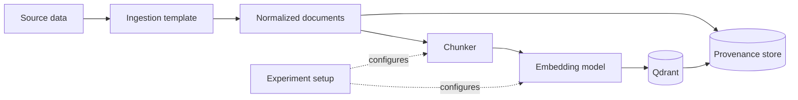
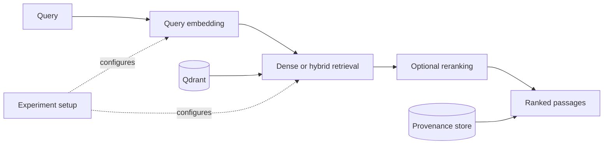

# Architecture

## Indexing

## Querying

Qdrant holds vectors and retrieval payloads. The provenance store records
documents, setup definitions, runs, and evaluation results so experiments remain
reproducible.

A query uses the setup's newest complete run. Points from an earlier ingest of
the same setup stay in the collection and are left out by the `run_id` filter.
There is no way to select that earlier run yet. A run stores the corpus
checksum, not the source path or URL, so the checksum is the only name the
older corpus has.

## Components

| Component | Role |
|---|---|
| Source data | Dataset files or manually created documents. |
| Ingestion template | Parses one input format into normalized documents. |
| Normalized documents | Common document ID, text, title, and metadata representation. |
| Experiment setup | Predefined chunking, embedding, indexing, and retrieval choices. |
| Chunker | Splits a document according to the selected strategy and profile. |
| Embedding model | Produces vectors for document chunks and queries. |
| Qdrant | Stores vectors and supports dense or hybrid retrieval. |
| Provenance store | Records corpus, setup, run, vector references, and evaluation metadata. |
| Dense or hybrid retrieval | Finds candidate chunks using vector-only or vector-plus-sparse search. |
| Optional reranking | Reorders the best candidates before they are returned. |
| Ranked passages | Retrieved chunks and their metadata, ready for evaluation or generation. |

